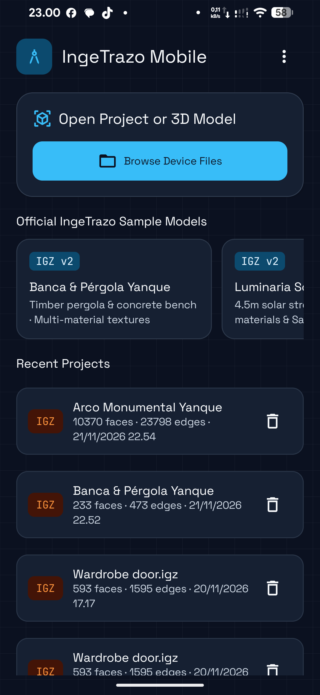
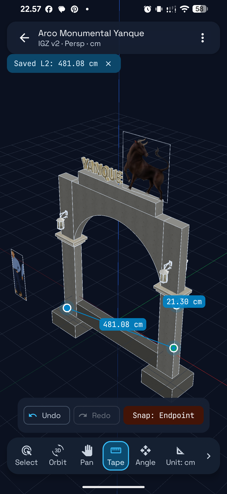
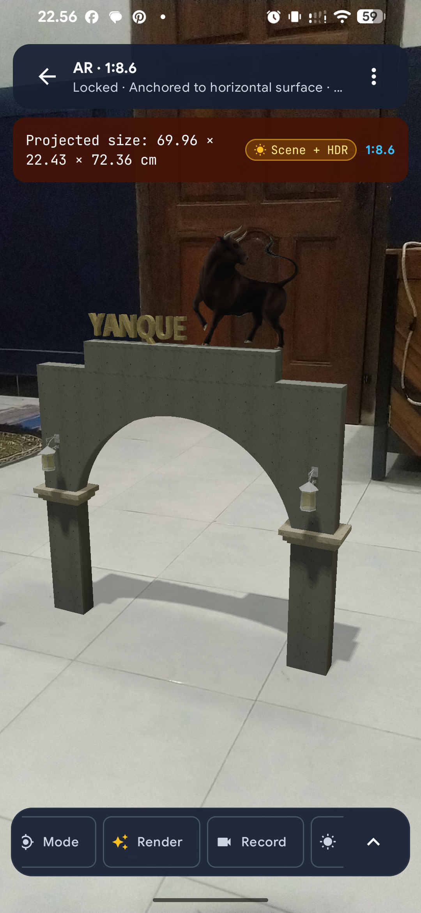
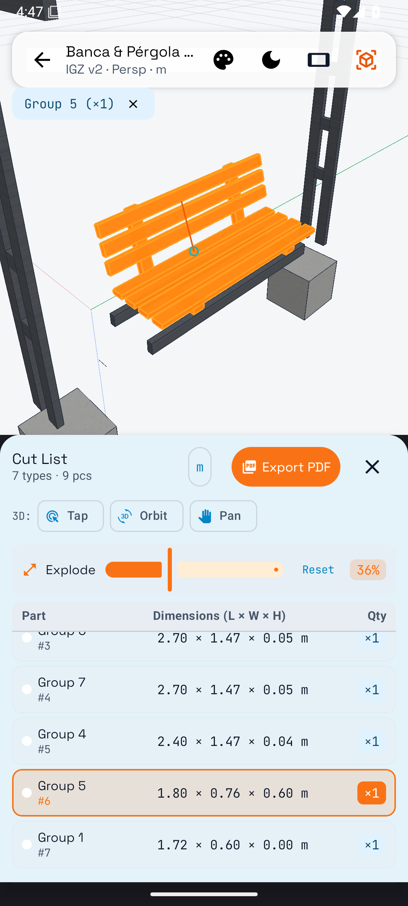

# IngeTrazo Mobile (`beta 0.2`)

**IngeTrazo Mobile** is an Android 3D CAD viewer, precision measurement suite, angle counter, automatic component-based 3D Cut List (Bill of Materials) generator with PDF export, and ARCore/VR projector built for native **IngeTrazo (`.igz`)** models alongside **SketchUp (`.skp`)**, **Wavefront (`.obj`)**, and **glTF 2.0 (`.gltf` / `.glb`)** files.

- **Creator**: [Brillian11](https://github.com/Brillian11)
- **Special Thanks**: [IngeTrazo Project (`ingelibre/ingetrazo`)](https://github.com/ingelibre/ingetrazo)
- **Current Version**: `beta 0.2`
- **License**: [GNU GPL-3.0-or-later](./LICENSE)

---

## Screenshots

| Project Hub (Dark Mode) | 3D CAD Viewer & Tape Measure |
| :---: | :---: |
|  |  |

| AR Projection (Realistic Scene + HDR & Record) | 3D CAD Viewer & Interactive Cut List |
| :---: | :---: |
|  |  |

---

## What the App Does

### 1. Native 3D CAD File Support & Project Hub
- **Android Storage Access Framework (SAF)** file picker (`OpenDocument`) with persistable URI permissions and zero broad storage permissions.
- **Bundled Official IngeTrazo Sample Models**:
  - *Banca & Pérgola Yanque* (`banca-pergola-yanque.igz`)
  - *Luminaria Solar Yanque* (`luminaria-solar-yanque.igz`)
  - *Arco Yanque* (`arco-yanque.igz`)
  - *Pileta Fuente Yanque* (`pileta-fuente-yanque.igz`)
  - *Capas & Secciones* (`capas-prueba.igz`)
  - *Pestañas & Escenas* (`pestanas-prueba.igz`)
- **Recent Projects History & Metadata Inspector**: View format version, bounding-box extents, vertex/edge/face/layer/texture counts, and configure display units (`m`, `cm`, `mm`, `ft`, `in`) and decimal precision from the header menu.

### 2. SketchUp-Like 3D Viewport (OpenGL ES 3.0)
- **Touch Navigation**: 1-finger Z-up turntable **Orbit**, 2-finger **Pan** and pinch **Zoom**, single-tap geometry selection, and double-tap **Zoom Extents**.
- **Camera & Saved Scenes**: Toggle **Perspective ↔ Orthographic** projection, apply 7 Standard Views (`Iso`, `Top`, `Bottom`, `Front`, `Back`, `Left`, `Right`), or jump directly to `.igz` `saved_views`.
- **Display Styles**: *Shaded + Edges*, *Textured*, *Monochrome*, *X-Ray*, and *Wireframe*, plus instant **Light / Dark CAD Workspace** theme switching.
- **Adaptive Toolbars with Overflow Indicators**: Top and bottom toolbars automatically display interactive left/right scroll arrows (`<` / `>`) when screen width is insufficient to show all tools simultaneously.

### 3. Magnetic Snap, Tape Measure, Protractor & Angle Counter
- **Magnetic Snap Engine**: Real-time screen-space and 3D raycast snapping to **Endpoints (Vertices)**, **Midpoints**, **On Edge**, and **On Face**.
- **Tape Measure (Length)**: 2-point snapped distance measurement with live rubber-band preview and unit-formatted readouts.
- **Protractor (Angle)**: Supports **3-Point**, **2-Edge**, and **2-Face (Dihedral)** angle measurement with 3D arc rendering.
- **Angle Counter & CSV Export**: Auto-detect angles in selected geometry, group by configurable degree tolerance (`±0.1°`, `±0.5°`, `±1.0°`), and export measurements and counts to **CSV**.

### 4. Automatic Component-Based 3D Cut List (BOM), Exploded View & PDF Export
- **Component-Level Geometry Extraction**: Automatically traverses the model hierarchy, decomposes multi-part groups into individual 3D solid **Components** (excluding non-component group containers and 2D reference billboards), computes rotation-invariant local oriented bounding boxes (`Length × Width × Height`), and groups identical components with quantities.
- **Bi-Directional 3D Highlighting & Camera Focus**:
  - Tapping a row in the Cut List highlights all matching component instances in glowing orange in the 3D viewport and smoothly animates the camera to frame them.
  - Tapping a component in the 3D viewport automatically scrolls to and selects its corresponding row in the Cut List table.
- **Interactive 3D Exploded View (`0%` – `100%`)**: Radially separates individual components outward from the model center in real time while preserving full Orbit, Pan, Zoom, and raycast selection.
- **Multi-Page A4 PDF Report Export**: Generates a formatted PDF report containing project metadata, a live 2D snapshot of the current (or exploded) 3D view, and a paginated Cut List table (`#`, `Part / Component`, `Dimensions (L × W × H)`, `Qty`). Saves directly to `Downloads/` via `MediaStore` and opens Android's native **Share Sheet** via `FileProvider`.

### 5. ARCore Projection & Stereo VR Box Mode
- **Consistent Physical Scale & Scale Presets (`1:1` to `1:100`)**: Projects 3D CAD models in real-world meters with true physical sizing.
- **Foundation / Below-Axis Toggle**: Bury sub-grade foundations below the detected floor plane (`Z < 0` clipped below the surface) or toggle full-structure visibility above ground.
- **Always-Level Gravity Lock**: Keep architectural structures plumb with gravity even when placed on inclined surfaces.
- **Textured & Shaded AR Rendering**: Full UV texture mapping and directional lighting inside the AR viewport.
- **VR Box Mode**: Stereoscopic side-by-side (SBS) VR headset view with barrel-distortion lens framing and sensor head-tracking (`TYPE_ROTATION_Vector`).

---

## Supported Formats Matrix

| Format | On-Device Support | Implementation Details |
| :--- | :--- | :--- |
| **IngeTrazo `.igz` Format 1** | **Full Native** | Plain UTF-8 JSON (`igz_format: 1`), Z-up coordinates in meters, `edges`, `faces` (with holes), `groups`, `protos` + 16-float `xform`, `layers`, `saved_views`, `dimensions`, `text_labels`, `section_planes`. |
| **IngeTrazo `.igz` Format 2** | **Full Native** | ZIP container with `document.json` + embedded `textures/*` PNG/JPG assets and planar UV projection (`sw`, `sh`, `rot`, `uvw`). |
| **IngeTrazo `.igz` Format 3** | **Full Native** | ZIP container with `document.json`, `textures/*`, and binary `geom/*.bin` buffers (`pos`, `edges`, `rings`, `ring_sizes`, `ring_counts`, `face_attr`). |
| **SketchUp `.skp` (VFF 2021+)** | **Full Native** | Clean-room Kotlin TLV reader (`SkpParser.kt`) decoding `model.dat` vertices, edges, face loops, component definitions, instances, layers, and materials. |
| **Wavefront `.obj`** | **Full Native** | Vertices (`v`), texcoords (`vt`), faces (`f`), polylines (`l`), objects/groups (`o`/`g`). |
| **glTF 2.0 (`.gltf` / `.glb`)** | **Full Native** | Binary `.glb` and embedded `.gltf` node hierarchies, meshes, PBR base colors, and textures. |

---

## How to Clone & Build

### 1. Prerequisites
- **Android Studio Ladybug (2024.2.1+)** or newer (or Android SDK Command-Line Tools with `compileSdk 36`).
- **JDK 17** or newer.
- **Git LFS** (recommended for handling large `.igz`, `.skp`, and `.glb` 3D sample files).

### 2. Clone with Git LFS
If you are adding or pulling large `.igz` 3D models or high-resolution textures, initialize **Git LFS** first (already configured in [`.gitattributes`](./.gitattributes)):

```bash
git lfs install
git clone https://github.com/Brillian11/ingetrazo-mobile.git
cd ingetrazo-mobile
```

When adding new large `.igz` models before pushing to GitHub:

```bash
git lfs install
git lfs track "*.igz"
git add .gitattributes
```

### 3. Build & Run Tests
Using Gradle (or `./gradlew` in Android Studio):

```bash
# Assemble the Debug APK (outputs to app/build/outputs/apk/debug/app-debug.apk)
gradle :app:assembleDebug

# Run the JVM Unit & Robolectric UI Test Suite
gradle :app:testDebugUnitTest
```

### 4. Auto-Generated APK & Changelog on GitHub Releases
This repository is pre-configured with [`.github/workflows/android-build.yml`](./.github/workflows/android-build.yml) and [`CHANGELOG.md`](./CHANGELOG.md) to automatically build, sign, and publish **`IngeTrazo-Mobile-beta-0.2.apk`** with a formatted changelog:

1. **Automatic GitHub Releases Page (on Every Push to `main`/`master` or Tag)**:
   - As soon as you push the project to GitHub (including pushing directly from AI Studio), GitHub Actions automatically:
     - Runs the unit & Robolectric tests and builds `IngeTrazo-Mobile-beta-0.2.apk`.
     - Generates release notes combining [`CHANGELOG.md`](./CHANGELOG.md), the recent Git commit log, build metadata, and the APK's `SHA-256` checksum.
     - Publishes `IngeTrazo-Mobile-beta-0.2.apk` directly to your repository's **Releases** page under tag `beta-0.2` (or your custom tag if you push a `v*` / `beta*` tag).
2. **GitHub Actions Artifacts**:
   - Every workflow run also uploads **`IngeTrazo-Mobile-beta-0.2-APK`** under the **Actions** tab → **Artifacts**.

---

## Roadmap & Upcoming Enhancements

- [x] Component-based **Automatic 3D Cut List (Bill of Materials)** generation with rotation-invariant `L × W × H` grouping.
- [x] Interactive **3D Exploded View (`0%` – `100%`)** and bi-directional 3D/table highlighting.
- [x] Multi-page **Cut List PDF Export** with embedded 3D viewport snapshot and Android Share Sheet integration.
- [x] **ARCore Projection** with Foundation clipping, Always-Level mode, UV textures, and **Stereo VR Box Mode**.
- [ ] **2D Sheet & Saw Kerf Nesting Layout Optimizer**: Visual board-cutting diagrams for sheet goods and linear stock inside the exported PDF report.
- [ ] **Interactive 3D Section Plane Slider**: Live draggable clipping planes from `.igz` `section_planes` in the 3D and AR viewports.
- [ ] **Direct `.igz` Scene Annotation Export**: Save on-device Tape and Protractor measurements back into exported `.igz` archives.

---

## Attribution, Credits & License

- **Creator**: Created by **[Brillian11](https://github.com/Brillian11)**.
- **Special Thanks & Upstream Attribution**:
  - **[IngeTrazo Project (`ingelibre/ingetrazo`)](https://github.com/ingelibre/ingetrazo)**: This project's `.igz` (v1–v3) file format compatibility and bundled sample `.igz` models (`app/src/main/assets/samples/`) are based on the open-source IngeTrazo desktop CAD project, licensed under the **GNU General Public License v3.0 (GPL-3.0-or-later)**.
  - **[OpenSKP (`iamahsanmehmood/openskp`)](https://github.com/iamahsanmehmood/openskp)**: The pure-Kotlin `.skp` VFF 2021+ parser (`SkpParser.kt`) is an independent clean-room implementation informed by the MIT-licensed OpenSKP format documentation.
- **License**: Distributed under the **GNU General Public License v3.0 (GPL-3.0-or-later)**. See [`LICENSE`](./LICENSE) for the full license text.
